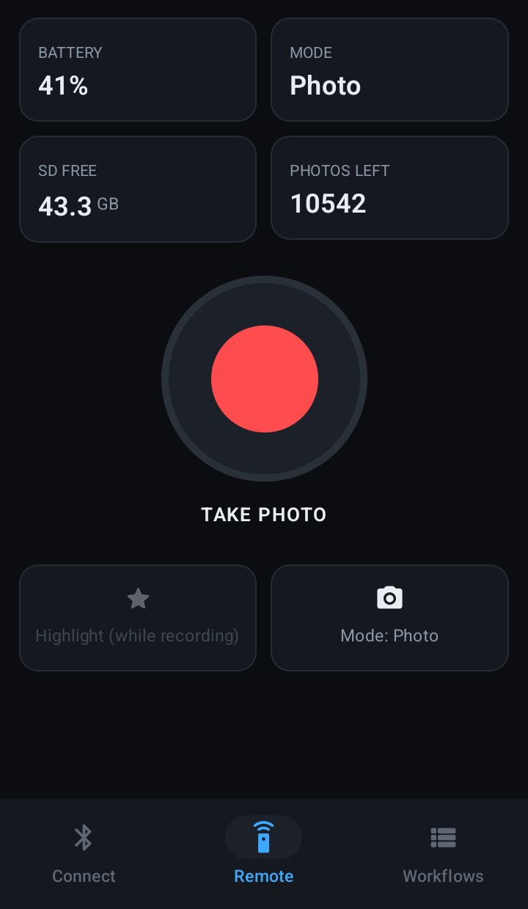
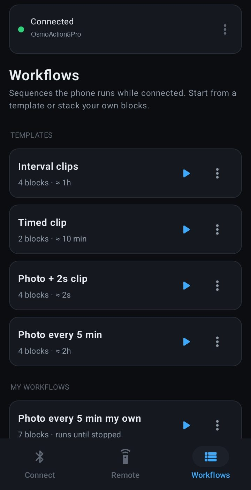
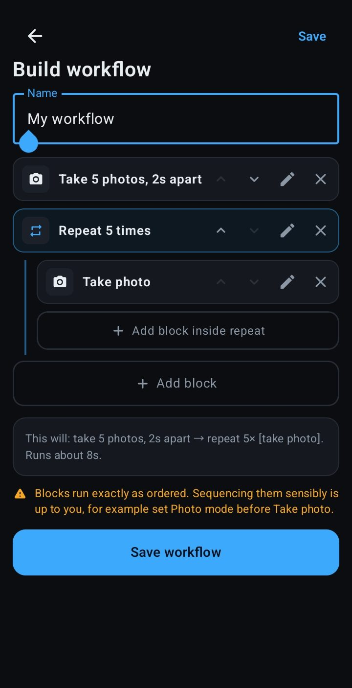
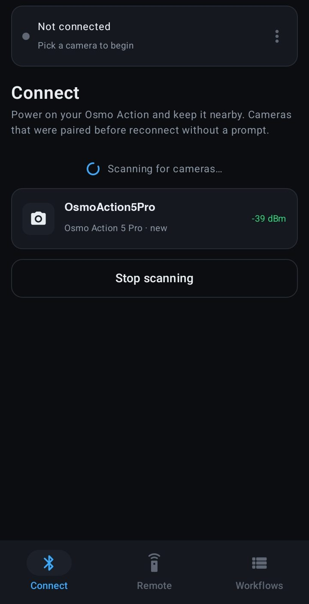
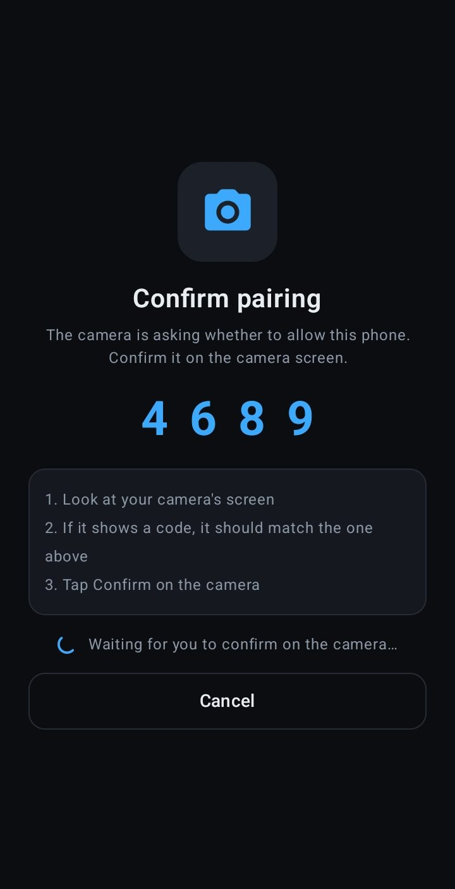
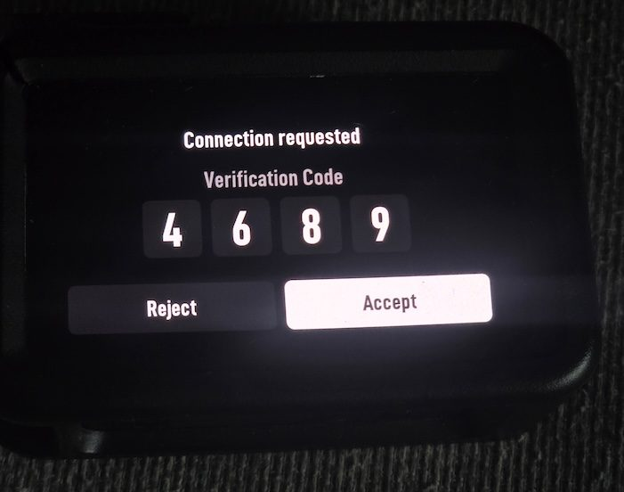
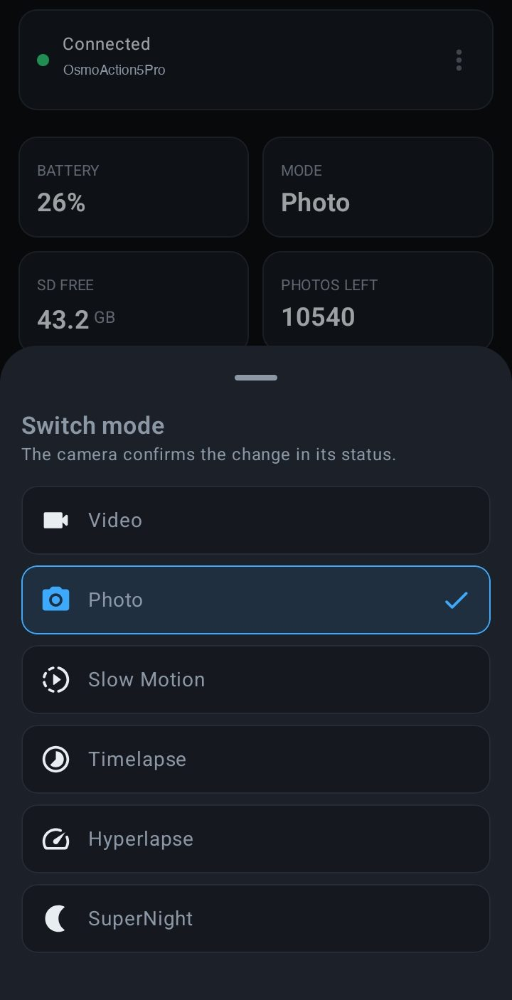
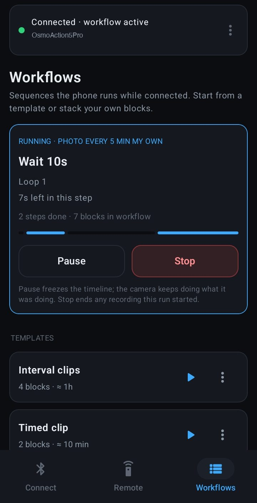
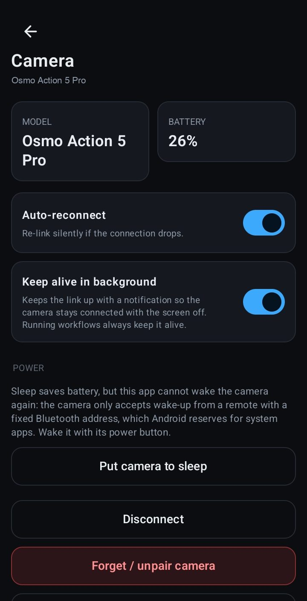

# OsmoActionRemote

A free, open-source **Android** remote for the **DJI Osmo Action 5 Pro**. It
talks to the camera over Bluetooth Low Energy using DJI's R SDK protocol. No
DJI Mimo, no account, no cloud.

It works with the phone alone. Add an optional **ESP32 on USB** and the app
can also wake the camera from sleep, which a phone cannot do by itself
([why](#esp32-relay-optional)).

  
  
  

## Features

- **Pairing**: confirm once on the camera, then it reconnects silently.
  Auto-reconnects if the link drops.
- **Live status** at 2 Hz: battery, mode, SD free space, recording time left,
  photos left, and a REC timer while recording.
- **Remote**: record / stop, take photo (in Photo mode), highlight tags while
  recording, and direct mode selection (Video, Photo, Slow Motion, Timelapse,
  Hyperlapse, SuperNight).
- **Sleep and wake**: put the camera to sleep and wake it again, from the
  Remote, the camera page, or a workflow. Waking needs the ESP32 relay.
- **Two routes, same app**: the phone's own Bluetooth, or an ESP32 plugged in
  over USB that relays every command. Pick one on the Connect screen.
- **Workflows**: build capture sequences from blocks (set mode, take photo,
  record for N seconds, start/stop recording, highlight, wait, repeat N times
  or until stopped, sleep, wake). Ships with templates such as interval clips and
  "photo + 2 s clip". Pause, resume, and stop at any time; stopping ends any
  recording the workflow started.
- **Runs in the background** with a notification, so workflows keep going
  with the screen off.
- **Share workflows** as JSON and import them from a file or by pasting.
- **Connection log** in the app for troubleshooting.

## Screenshots

| Connect | Pairing (phone) | Pairing (camera) |
| --- | --- | --- |
|  |  |  |

| Mode picker | Running workflow | Camera page |
| --- | --- | --- |
|  |  |  |

The Remote also warns when the camera is in playback, where it ignores
commands ([screenshot](docs/screenshots/playback.jpg)).

## Known limitations

- **Waking the camera needs the ESP32 relay** and camera firmware
  01.04.08.10 or later. The camera only accepts the wake broadcast from a
  fixed (public) Bluetooth address, and Android gives normal apps a random
  one. On the phone route the app still sends the wake broadcast, but the
  camera will most likely ignore it; wake it with its power button instead.
  Details in [`docs/PROTOCOL.md`](docs/PROTOCOL.md#sleep-and-wake).
- **No live preview or media download.** Those use the camera's Wi-Fi.
- **Screen brightness, screen-off and auto power-off** are not in DJI's
  Bluetooth protocol. Set them on the camera. For long workflows, set auto
  power-off to the longest option, because the app cannot turn the camera back on.
- **Commands are ignored in playback.** Leave playback on the camera first.
- Only tested with the Osmo Action 5 Pro. Action 4, Action 6, and Osmo 360 use
  the same protocol but are untested.

## Install

1. Download the latest `.apk` from the [Releases](../../releases/latest) page
   on your phone.
2. Open it. If Android asks, allow your browser or file manager to install
   unknown apps.

Requires Android 12 or newer with Bluetooth LE. The app asks for Bluetooth
(nearby devices) and notification permissions, and never uses location. The
ESP32 route also needs USB host (OTG) support, which almost every phone has.

To build it yourself, see [`android/README.md`](android/README.md).

## Using it

1. Turn on the camera and open the app. It scans automatically.
2. Tap your camera. The first time, confirm the pairing prompt on the camera.
3. The **Remote** tab opens. The big button records, or takes a photo in Photo
   mode. Use **Mode** to switch modes and **Highlight** while recording.
4. **Workflows**: run a template, or build your own. A Repeat block shows its
   contents indented underneath; use **Add block inside repeat** to fill it.
   Blocks run exactly as ordered, so set the right mode before capturing.
5. Tap the bar at the top to manage the camera: sleep, wake, disconnect,
   forget, background keep-alive, and the connection log.

## ESP32 relay (optional)

A cheap ESP32 board plugged into the phone gives the app a Bluetooth radio
with a fixed address, which is what the camera needs to accept a wake-up.
The app keeps all the camera logic; the ESP32 only relays bytes, so every
feature behaves the same on both routes.

1. **Get a board**: ESP32-C3 or ESP32-S3 with USB-C, or an original ESP32 dev
   board, plus a USB OTG cable for your phone.
2. **Flash it**: download `osmo-bridge-<chip>.bin` from the
   [latest release](../../releases/latest) and write it at address `0x0` with
   any ESP flasher, for example the
   [esptool-js](https://espressif.github.io/esptool-js/) web flasher, an
   Android flasher app over USB OTG, or `esptool`. The app links to the
   download and the instructions from the Connect screen.
3. **Plug it into the phone**, open the app, choose **ESP32 on USB** on the
   Connect screen, and pair once on the camera.
4. **Update the camera firmware** to 01.04.08.10 or later if it is older
   (DJI Mimo app). Older firmware ignores the wake broadcast.

Boards, all flashing options, building from source and the serial protocol
are in [`firmware/README.md`](firmware/README.md).

## Project layout

| Path | What it is |
| --- | --- |
| [`android/`](android/README.md) | The app: `:protocol` (codec), `:core` (session, reconnect, workflow engine, ESP32 bridge client), `:app` (Bluetooth, USB, UI) |
| [`firmware/`](firmware/README.md) | ESP32 relay firmware (osmo-bridge) and the build script for the release images |
| [`tools/mac-probe/`](tools/mac-probe/README.md) | Python tools used to reverse-engineer and verify the protocol from a Mac, directly or through the ESP32 relay |
| [`docs/PROTOCOL.md`](docs/PROTOCOL.md) | Verified protocol notes: frame format, CRCs, handshake, commands, status fields |

## Roadmap

- Flash the ESP32 relay from inside the app
- GPS injection from the phone into recordings
- QR code sharing for workflows
- Show the camera's mode details (for example "4K 60fps")
- Test Action 4, Action 6, and Osmo 360
- Multi-camera control

## Credits

Built on public reverse-engineering work, especially DJI's own
[Osmo-GPS-Controller-Demo](https://github.com/dji-sdk/Osmo-GPS-Controller-Demo)
(R SDK protocol and CRC parameters),
[rhoenschrat/DJI-Remote](https://github.com/rhoenschrat/DJI-Remote),
[theserialhobbyist/M5StickCPlus2_Remote_For_DJI_Osmo](https://github.com/theserialhobbyist/M5StickCPlus2_Remote_For_DJI_Osmo),
and [dstrat28/action-multicam-remote](https://github.com/dstrat28/action-multicam-remote).
Full list in [`docs/PROTOCOL.md`](docs/PROTOCOL.md#sources).

## Disclaimer

Independent project, **not affiliated with, endorsed by, or sponsored by
DJI**. "DJI", "Osmo", and "Osmo Action" are trademarks of their owners, used
only to describe compatibility. Use at your own risk; see [`NOTICE.md`](NOTICE.md).

## License

[MIT](LICENSE).
